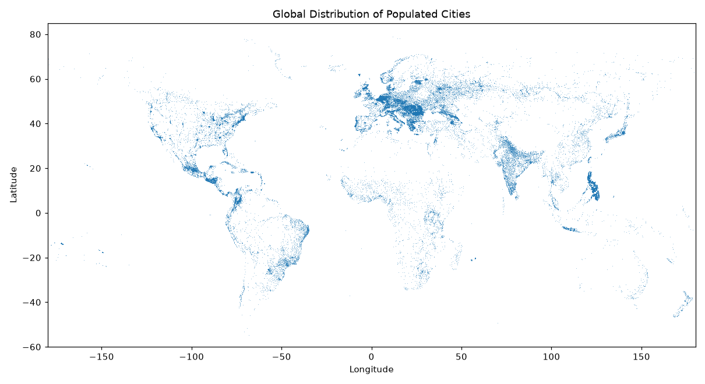

# FU WANTING

Data Science student at the University of Macau. I work with Python to load,
explore, and visualize real-world datasets, and I enjoy turning raw data into
clear, readable charts that support a finding.

## Technical Skills

- **Programming:** Python
- **Data handling:** pandas, NumPy
- **Visualization:** matplotlib, seaborn, geoplotlib
- **Workflow:** Jupyter notebooks, Git/GitHub

## Project Showcase

### Global City Distribution Analysis

**Research question:** How are cities distributed across the globe, and which
countries hold the densest urban networks?

**Finding:** Populated cities cluster along coastlines and in temperate
latitudes, with dense bands across Europe, South Asia, and East Asia, while the
United States, China, and India report the largest number of cities.

**Dataset:** GeoNames cities dump (CC-BY 4.0), 3.17 million records.

[View the project repository](https://github.com/mc66092/data-science-project)

**Status:** completed
